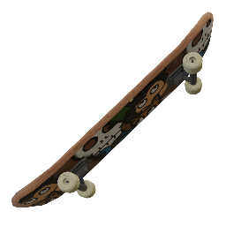

## Revived 3.1 Update (WIP)

### Highlights
- New VehicleWear, **Skateboard**.

---

### New Items

- New VehicleWear, **Skateboard**.
    - <b>[Passive] Skateboarding</b> Replaces sprinting with mounting skateboarding, crouch to dismount.

---

### Misc, balancing and new player experience

- `xm1014` and `mp5` are no longer dropped by Zombies.
    - New `xm1014` claimable in the Warehouse Safehouse by killing 100 Zombies.
    - New `mp5` claimable in the Sundays Safehouse by reaching Mastery Level 20.